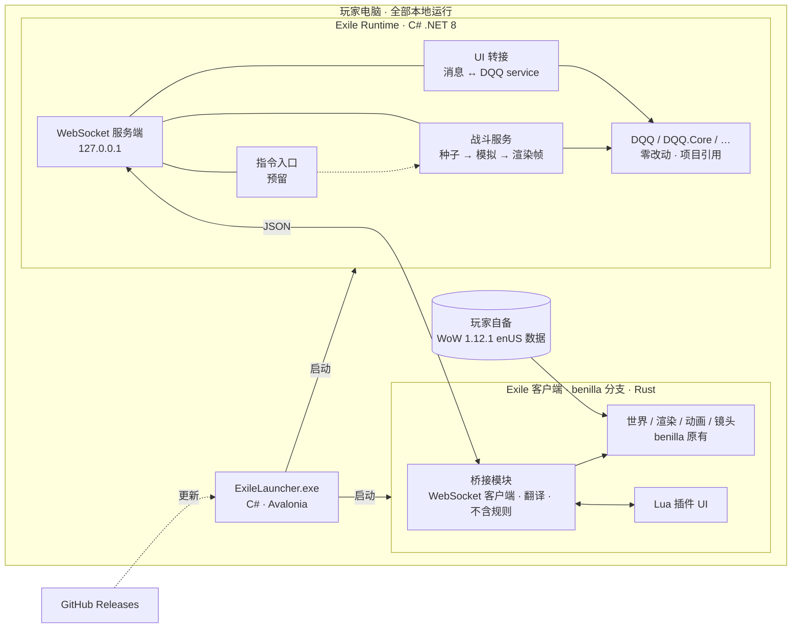

# Exile of Azeroth 总体架构

| 字段 | 内容 |
|------|------|
| 作者 | Claude（根据 2026-11-06 与用户的讨论整理） |
| 创建日期 | 2026-11-06 |
| 状态 | **已定稿**（2026-11-06，用户确认） |
| 关联计划 | PLAN-0002（调研与选型，已完成）、PLAN-0003（验证） |
| 讨论过程 | [archive/architecture-discussion-2026-11-06.md](archive/architecture-discussion-2026-11-06.md) |

---

## 1. 一句话

用 **WoW 1.12.1 客户端的资源和画面**（经由改造过的 benilla 客户端）做「皮」，用 **DQQ 的挂机战斗和全部业务逻辑**（在独立的 C# runtime 里，零改动）做「骨」，两者通过本机 WebSocket 交换消息。整个游戏在玩家自己的电脑上本地运行。

## 2. 已确定的决策

| # | 决策 |
|---|------|
| D1 | 核心逻辑只用 **C#**：DQQ 和所有业务逻辑跑在独立的 C# runtime 里。 |
| D2 | 客户端用 **benilla 分支**（Rust），其中加一个 **Rust 桥接模块**，只负责与 runtime 交换信息和驱动画面，不含任何玩法规则。不使用 WoW 网络协议，不模拟 WoW 服务器，不支持原版 WoW.exe。 |
| D3 | **DQQ 源码零改动**，按项目引用接入，源码位于 `C:\code\dqq\DQQ`。DQQ 是用户自己的项目。 |
| D4 | 玩法分**非战斗**和**战斗**两部分（§4、§5）。 |
| D5 | 界面照艾泽拉斯之潮的做法，做成客户端内的 **Lua 插件**。界面操作通过消息调用 DQQ 现有的 service。 |
| D6 | 战斗模式有自动、回放、手动三种，**走同一条渲染路径**：DQQ 每个 tick 产出日志，客户端照着渲染。 |
| D7 | 手动操作（WASD 按面向移动、右键改朝向）以后统一成**标准指令**，现阶段**只留设计口子**。 |
| D8 | 镜头保留 **WoW 第三人称**。 |
| D9 | **协议先行、传输可替换**（方案三，2026-11-06 用户确定）：两边只认 `ui.*`/`scene.*`/`combat.*`/`cmd.*` 消息，传输层可在「两进程 WebSocket」与「同进程函数调用」之间替换。**传输先用两进程本机 WebSocket + JSON**（2026-11-06 用户确定）：runtime 按 tick 推送渲染帧（带 tick 编号），客户端**先尝试不缓冲**、收到即播（帧间插值），实测有抖动再加缓冲；runtime 开启后台 GC 与低延迟模式。验证阶段实测端到端延迟、帧间抖动、GC 暂停时长，不达标再换同进程传输，业务代码不变。 |
| D10 | 照艾泽拉斯之潮做**启动器**：Avalonia，只做 Windows，放在 `WoW.exe` 同目录，从本仓库的 GitHub Releases 获取更新。 |
| D11 | 客户端由我们**编译好后随发布包分发**，玩家不需要装 Rust。 |
| D12 | **没有寻路**：移动和找目标都用 DQQ 自己的逻辑，安装时不需要生成导航网格。 |
| D13 | **暂不做浏览器版**。 |
| D14 | runtime 引用 DQQ 的三个核心项目：**DQQ、DQQ.Core、DQQ.Web.Component**（后者包含各种 service 的实现）。 |
| D16 | 验证阶段的 DQQ 服务器：`https://pogapi2.idlepog.com/`。测试账号写在本地文件 `config/dev.local.json`，**已被 git 忽略，不要提交**；模板见 `config/dev.example.json`。 |
| D17 | **对应表写在代码里，编译时打包**：DQQ 枚举 → WoW 资源（职业/武器/装备 → 模型与装备外观，怪物 → 模型，技能 → 动画与特效，元素 → 法术学派）、藏身处布局、战场配置，都写成 runtime 代码中的静态表，不做运行时存储。 |
| D18 | **界面默认中文**，文本使用 DQQ.Core 自带的中文资源（DQQ 已有中英文本地化）。enUS 客户端字体没有中文字形，所以**发布包要附带一个中文字体**（选用允许再分发的字体，如 SIL OFL 许可的字体）。 |
| D19 | **默认后台挂机**：待在藏身处时，战斗在后台一场接一场地计算，界面显示进度条等挂机状态；想看时可以进战场观看或播放回放。 |
| D20 | **跳过 WoW 登录，直接进入选人画面**：通过 DQQ 的 CharacterService 获取角色列表；按角色的职业（战斗风格）和武器装备渲染模型；**默认种族为人类女性**。 |
| D21 | **本仓库公开**（GitHub Releases 可匿名下载，启动器不需要认证）。 |
| D22 | **benilla 改版 fork 到 GitHub，作为本仓库的子模块**（同艾泽拉斯之潮）。 |
| D23 | **DQQ 以编译好的 DLL 接入**：仓库根目录建 `source/`，放入编译好的 DQQ、DQQ.Core、DQQ.Web.Component 的 DLL；runtime 引用 `source/` 里的 DLL，而不是 DQQ 源码。GitHub 上编译时不需要 DQQ 源码，也不需要访问令牌，DQQ 不必开源。（本地开发时，`C:\code\dqq\DQQ` 仍是 DQQ 的源码位置。） |
| D24 | `C:\wow_survival` 是之前的验证原型（`csp/` C# 战斗显示服务、`wenilla/crates/dqq-world-demo` 显示端、`RESEARCH.md`）。**只作参考，本项目重新编写**，不迁移其代码。 |
| D25 | 客户端 fork **原版 benilla**（samwhosung/benilla），不用 wenilla。fork 地址：`https://github.com/rehee/benilla`；本仓库：`https://github.com/rehee/ExileofAzeroth`（公开）。子模块放在 `client/`（同艾泽拉斯之潮）。 |
| D26 | **客户端退出时 runtime 也退出**，不在后台常驻；挂机只在游戏运行期间进行。 |
| D27 | **自由模式**（2026-11-06）：选人后进入世界即为自由模式，玩家用 WoW 默认操作控制角色；不自动开战。 |
| D28 | **战斗（回放）模式**（2026-11-06）：玩家选择一场战斗录像后进入。先读条传送到战场；进入后隐藏自由模式的 NPC 与可交互物品；镜头默认以 WoW 追尾方式跟随**创建这场战斗的角色**，玩家可以转动、调整镜头。 |
| D29 | **回放期间玩家操作不影响战斗**（2026-11-06）：玩家的移动等操作不传给战斗；镜头不自动复位，完全由玩家控制。 |
| D15 | DQQ 的 service 分在线和离线两种：在线通过 HTTP service 和 DQQ 服务器交换数据；离线目前走浏览器的 IndexedDB。**验证阶段 runtime 使用在线模式**。以后由用户把离线实现抽出来，改用本地 SQLite 文件，到时 runtime 切换到离线模式，实现完全本地运行（属于 DQQ 侧的工作）。 |

## 3. 总体结构



| 组件 | 语言 | 职责 | 不做的事 |
|------|------|------|----------|
| Exile Runtime | C# | 运行 DQQ（引用 DQQ、DQQ.Core、DQQ.Web.Component）；把界面消息转给 DQQ service（验证阶段为在线模式，经 HTTP 连 DQQ 服务器；以后为离线 SQLite）；战斗模拟与渲染帧生成；指令入口（预留）；存档 | 不碰渲染 |
| 桥接模块 | Rust | WebSocket 收发；把渲染帧翻译成客户端里的单位、移动、动画、特效、伤害数字；把界面操作转成消息；采集玩家输入（预留） | 不含规则、数值、随机 |
| Lua 插件 | Lua | 全部界面：地图仪、特质、技能、装备/仓库、重铸、过滤器、战斗 HUD、结算 | 不含规则 |
| benilla 原有部分 | Rust | 资源加载、世界渲染、模型动画、本地移动与碰撞、镜头、FrameXML 引擎 | 尽量不改，改动集中在本项目自己的 crate 里 |
| 启动器 | C# | 校验客户端、更新、备份、安装、启动 | — |

对照参考项目：
- 结构上像**艾泽拉斯之潮**：benilla 分支客户端、Lua 插件界面、启动器。
- 运行方式像 **Azeroth Survivors**：客户端不连 WoW 服务器，由玩法直接驱动客户端里的单位。
- 区别在于：玩法逻辑放在独立的 C# runtime 里，而不是 C++ 服务端或 Rust 客户端里。

## 4. 非战斗：藏身处

- 场景**自己布置**，形式类似 PoE 的藏身处：**中间是地图仪**，用来选图和开战；**周围一圈功能设施**。
- 世界和 NPC 只是功能入口。走到设施旁或点击它，就打开对应的插件界面：

| 设施 | 打开的界面 | 对应 DQQ |
|------|------------|----------|
| 地图仪 | 地图选择、难度、开始战斗/挂机 | 地图、难度、大秘境、挂机 |
| 特质（天赋） | 天赋页面 | 人物特质 Trait（DQQ 以后增加更多系统时，再加对应设施） |
| 技能 | 技能槽：主动 + 辅助 | 技能 |
| 装备 / 仓库 | 装备栏、背包、仓库 | 物品 |
| 重铸 | 重铸 | 重铸 |
| 过滤器 | 物品过滤器 | 过滤器 |
| 回放 | 最近战斗、播放回放 | 回放 |

- **走动和 NPC 交互只在客户端本地处理**，不通知 DQQ。
- **界面操作全部调用 DQQ 现有的 service**，例如穿装备、调整技能：插件发消息 → runtime 调用 DQQ 对应的 service（验证阶段在线模式，以后离线 SQLite）→ 结果返回插件刷新界面。runtime 只做转接，不另写业务逻辑。
- 消息名与 DQQ service 一一对应，例如 `ui.item.equip`、`ui.skill.set`。DQQ 新增 service 时，只需加一条对应关系。
- 藏身处的布局（设施位置、模型、触发半径、对应界面）是一份配置，由 runtime 下发，客户端照着摆放。

## 5. 战斗

### 5.1 进入与离开

（2026-11-06 细化，见 D27–D29）自由模式 → 选择战斗录像 → 读条传送 → 战斗模式（隐藏自由模式物件，镜头追尾跟随战斗创建者，玩家操作不影响战斗）→ 结束后传送回自由模式。

实现方式（验证阶段）：战斗中由玩家本体扮演战斗创建者——客户端收到"失去控制"（与坐飞行点相同的机制），本体的移动由回放驱动，镜头沿用 WoW 原生追尾，玩家只能调整镜头；战斗结束交还控制并传送回原处。

以下为原定稿内容：

1. 在地图仪选好地图和难度，开始战斗。
2. 读条传送：显示施法条和加载画面，从藏身处传送到战场。
3. 到达战场后，**隐藏非战斗角色**。战场上的所有单位，包括玩家英雄，都按快照和日志渲染。
4. 战斗结束：显示结算，然后传送回藏身处，恢复非战斗角色。

### 5.2 战场与坐标

- 暂时用**一个空旷的场景**作为通用战场，在里面框定 DQQ 战斗范围。以后做一个功能，把 DQQ 的 `EnumMap` 和具体场景一一对应。
- DQQ 坐标是 double 的 (x, y)，地图默认 10×10 世界单位。换算公式：
  `WoW (x, y) = 战场原点 + 旋转(朝向) × 缩放 × (DQQ x, DQQ y)`
  高度 z 由桥接按 ADT 地形取地面高度（桥接线程读取战场附近的地形块，`net/exile.rs` 的 `Ground`；生物高度本来由服务器给，客户端不会自己贴地）。
  朝向：DQQ 只给投射物设 `Angle`，角色与怪物恒为 0；客户端移动时面向移动方向，站立时面向 DQQ 当前目标（`targetX/targetY`）。
  移动按 5 帧一段演出（用户 2026-11-06 规则）：开始移动至少播 5 帧移动动画；5 帧后若已停下则停，仍在移动则直接接上下一段，动画不重播。为此客户端把战斗帧延后 5 帧（约 0.17 秒）显示，每段路径提前已知。DQQ 的 `moving` 标志与实际位移一致（实测 5592 帧移动且有标志，12 帧有标志但没动，0 帧无标志却移动）。
  阴影使用 WoW 原版的单位阴影（用户 2026-11-06 决定：自制的黑色圆盘太出戏，不用）。缩放暂定 1 单位 ≈ 3 码，以实际手感为准。
- 每个场景的配置（大陆、原点、朝向、缩放、范围）是一份数据。

### 5.3 渲染流程

```text
开始战斗（自动 / 回放 / 手动）
  → runtime 用种子初始化 DQQ 战斗；种子携带各方快照（角色、装备、技能…）
    （回放 = 用记录的种子和指令序列重新模拟，DQQ 已支持）
  → 每个 tick：DQQ 产出日志 + 单位快照 → runtime 打包成渲染帧 → WebSocket 发给客户端
  → 客户端桥接模块渲染：
      单位和投射物的出现、消失、位置（帧间插值）
      按日志选动画：例如"角色 A 施放了技能 X" → A 播放攻击/施法动画
      伤害和治疗数字、死亡、Buff/Debuff 表现、技能范围特效
  → 战斗结束：结算发给插件显示
```

- 客户端在战斗中**只渲染日志**，不自己决定任何结果。
- 节拍：DQQ 是 30 tick/s。可以每个 tick 发一帧，客户端插值平滑。
- runtime 侧的渲染帧生成可以沿用 DQQ.Ember 已有的思路（`EmberFrameAdapter`：TickRenderParameter → 渲染帧；`VisualMap`：DQQ 枚举 → 表现资源）。

### 5.4 日志与表现的对应

| DQQ 信息 | 客户端表现 |
|----------|------------|
| 职业、怪物枚举 | 模型、体型缩放 |
| 施放技能 + 技能标签（Attack+Melee / Spell / Range…） | 动画：近战攻击、施法、射击… |
| `RenderPhase` 的 Launch / Impact | 投射物出现、命中特效 |
| `SkillShape`（All / Cleave / Chain / Ray / Scatter） | 新星圈、扇形、闪电链、光束、散射 |
| 伤害、治疗（元素、暴击） | 飘字，按元素着色 |
| 击杀、倒下 | 死亡动画，延迟移除 |
| 持续效果（Buff/Debuff 标签） | 光环特效、图标 |
| 单位快照（位置、朝向、是否移动、生命） | 位置插值、走路/待机动画、血条 |

对应表是数据（JSON），由 runtime 维护和下发。初稿思路：DQQ 的海滩/螃蟹对应黑海岸的海岸蟹，地精对应地精，狼人对应银松森林的狼人；元素对应法术学派（物理、火焰、冰霜、自然、暗影）。

### 5.5 手动模式（设计口子）

- DQQ 已经支持在战斗中实时接收指令，并按 tick 记录、随回放保存（`CombatAction`、`Map.Actions`、`CombatActionJson`）。目前的指令是一次点击，带一对 double 坐标。
- 本项目**不做鼠标点地面**。操作沿用 WoW 的习惯：WASD 按角色面向前后移动，按住右键改朝向。
- 这些输入以后统一成标准指令，再交给 DQQ。指令集和 DQQ 侧的支持方式另行设计。
- 现阶段只做三件事：桥接协议预留 `cmd.*` 消息；客户端预留输入采集点；runtime 预留指令入口。**不把输入转成 DQQ 现有的点击事件。**

## 6. 桥接协议（本机 WebSocket + JSON）

| 项 | 约定 |
|----|------|
| 连接 | runtime 在 127.0.0.1 上开 WebSocket 服务，客户端桥接模块去连；传输层可替换为同进程调用（D9） |
| 时钟 | runtime 按 DQQ tick（30/s）推送渲染帧，帧带 tick 编号；客户端先尝试不缓冲，收到即播，实测有抖动再加缓冲 |
| 编码 | JSON；每条消息带协议版本、序号、类型 |
| 消息类别 | `ui.*`：界面请求和数据；`scene.*`：藏身处和战场的布置；`combat.*`：开始、渲染帧、结束、结算；`cmd.*`：玩家指令（预留） |
| 演进 | 以后有性能需要，再考虑换成二进制编码 |

具体字段在实现阶段另写协议文档（`docs/bridge-protocol.md`）。

## 7. benilla 不连服务器运行

benilla 本身需要连服务器才能运行。我们参考成熟的例子：
- **Azeroth Survivors**：`crates/benilla-app/src/survivors/` 在客户端里直接驱动单位，没有服务器。
- **艾泽拉斯之潮**：客户端分支的组织方式，项目代码集中在 `client/crates/hoa`，用子模块管理。

具体做法在验证阶段确认。

## 8. 启动器与发布

**启动器 `ExileLauncher.exe`**：C#、Avalonia、只做 Windows，放在 `WoW.exe` 同目录。

| 步骤 | 内容 |
|------|------|
| 1 校验 | 确认所在目录是 WoW 1.12.1（build 5875）enUS 客户端 |
| 2 检查更新 | 读取 GitHub Releases 上的发布清单（版本号、文件、哈希），和本地对比 |
| 3 下载 | 只下载有变化的组件，逐个校验哈希 |
| 4 备份 | 覆盖前备份，保留最近几份，失败时可以回滚 |
| 5 安装 | 放置 runtime、客户端、插件。**不修改 `WoW.exe` 和原有 MPQ**，存档不被覆盖 |
| 6 启动 | 先在后台启动 runtime，就绪后再启动客户端；**客户端退出时 runtime 也退出**（不做托盘常驻，D26） |
| 7 自更新 | 启动器有新版本时，先更新自己 |

**安装后的目录（草案）**

```text
WoW 目录/
  WoW.exe、Data/                 原版，不动
  ExileLauncher.exe
  Exile/
    client/Exile.exe             benilla 分支客户端（含桥接模块）
    runtime/                     Exile Runtime（含 DQQ）
    data/                        存档
    backups/  logs/  version.json
  Interface/AddOns/Exile*/       Lua 插件
```

- "获取最新的逻辑"，大多数情况下就是替换 runtime 和插件，因为逻辑都在 C# runtime 里。
- 插件和补丁文件的确切位置，取决于 benilla 分支怎么读取它们，到验证阶段确认。

## 9. 合规

和两个参考项目一样：
- 不分发任何暴雪资源，玩家自备 1.12.1 客户端。
- 声明本项目是非官方的粉丝项目。
- benilla 是 MIT 或 Apache-2.0 许可，可以修改和分发；分发时要附带它的许可声明。

## 10. 待确认事项

以下问题均已有结论（2026-11-06）。验证计划见 PLAN-0003。

1. ~~DQQ 在桌面进程里的存档~~ ✅ 见 D15：验证阶段用在线模式；以后用户抽出离线实现，改用本地 SQLite。
2. ~~runtime 引用哪些 DQQ 项目~~ ✅ 见 D14。**仍需在验证阶段确认**：DQQ.Web.Component 是 Blazor 组件库，在普通 .NET 进程（非浏览器）里以在线模式初始化各 service 是否顺利（依赖注入、HttpClient、认证 token、可能的 JS 依赖）。
2a. ~~验证阶段的 DQQ 服务器~~ ✅ 见 D16。
3. ~~DQQ 之外的数据存在哪~~ ✅ D17、D20。
4. ~~中文显示~~ ✅ D18。
5. ~~挂机与观看~~ ✅ D19。
6. ~~登录与选角~~ ✅ D20。
7. ~~GitHub 上编译时 DQQ 从哪来~~ ✅ D21、D23。

   `source/` 的实施要点（实现时处理）：
   - **依赖全部带上**（已确定）：三个 DLL 依赖的所有程序集（ReheeCmf、BootstrapBlazor 等 NuGet 包的 DLL）全部放进 `source/`，runtime 只依赖 `source/`，不再单独引用这些 NuGet 包。
   - **中文资源**：DQQ 的中文文本在附属程序集里（如 `zh-Hans/DQQ.Core.resources.dll` 这类按语言分的子目录），要一并放入，否则界面只有源码里的回退文本。
   - **版本记录**：`source/` 里放一个说明文件，记录这批 DLL 来自 DQQ 的哪个版本/提交、编译时间。
   - **更新方式**：写一个脚本，从本地 `C:\code\dqq\DQQ` 编译并把输出复制到 `source/`，更新 DQQ 时运行一次再提交。
   - **反编译**（已确定）：`source/` 里的 DLL 随仓库公开，可以被反编译，用户表示无所谓，**不做混淆**。

8. ~~benilla 分支放在哪~~ ✅ D22。

## 变更记录
| 日期 | 修改人 | 说明 |
|------|--------|------|
| 2026-11-06 | Claude | 新增 D27–D29：自由模式、战斗（回放）模式、回放期间操作与镜头规则 |
| 2026-11-06 | Claude | D9 定稿：协议先行 + WebSocket 传输，runtime 推送，客户端先不缓冲；新增 D26 客户端退出 runtime 随之退出 |
| 2026-11-06 | Claude | 新增 D24（原型仅作参考、重写）、D25（fork 原版 benilla）；D9 重新讨论中 |
| 2026-11-06 | Claude | 用户确认，状态改为「已定稿」 |
| 2026-11-06 | Claude | D23 细化：依赖全部放入 `source/`；不做混淆 |
| 2026-11-06 | Claude | 补充 D23：DQQ 以编译好的 DLL 放在 `source/` 接入；待确认事项全部关闭 |
| 2026-11-06 | Claude | 补充 D17–D22：对应表写在代码里、默认中文与字体、后台挂机、跳过登录直接选人、仓库公开、benilla 子模块 |
| 2026-11-06 | Claude | 补充 D16：验证用 DQQ 服务器地址；测试账号放在被 git 忽略的本地配置 |
| 2026-11-06 | Claude | 补充 D14、D15：DQQ 三个核心项目；验证阶段用在线模式，离线 SQLite 由用户后续抽离 |
| 2026-11-06 | Claude | 根据讨论稿 v0.5.3 整理为干净版本；讨论稿移至 archive/ |
