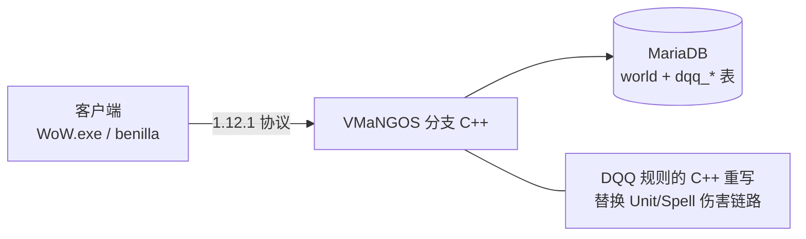
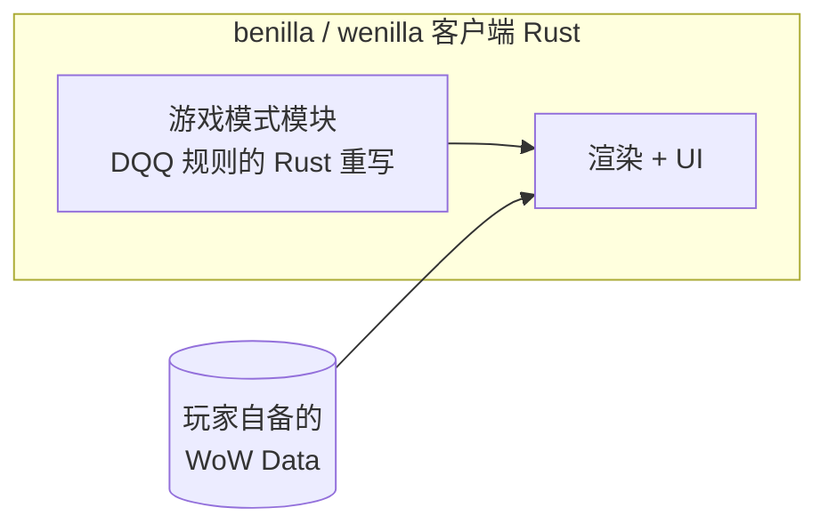
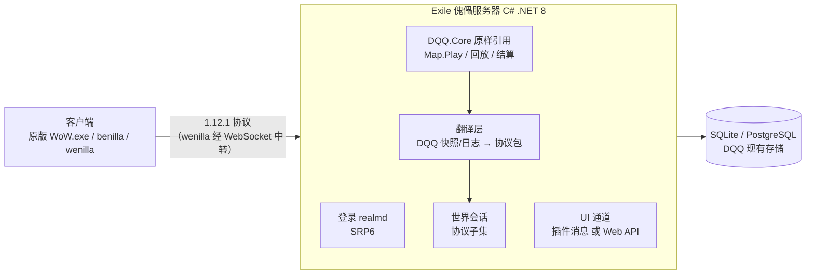
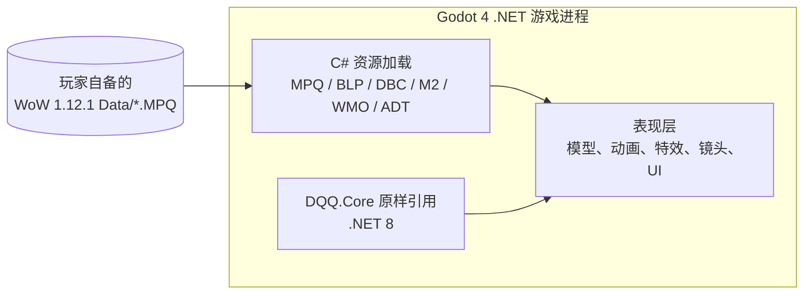
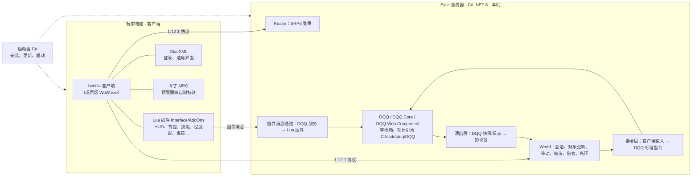
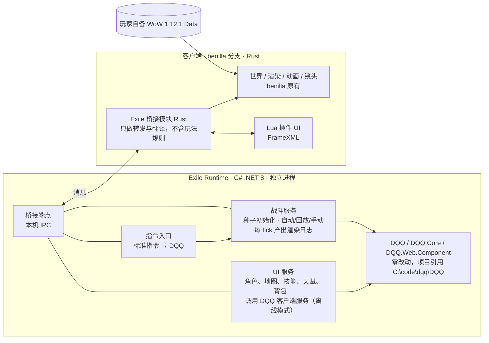

# 技术调研与架构方案（讨论稿）

| 字段 | 内容 |
|------|------|
| 作者 | Claude |
| 创建日期 | 2026-11-06 |
| 状态 | v0.5 讨论中（当前方案 T，尚未定稿） |
| 关联计划 | PLAN-0002 |
| 输入 | 参考项目 1《Hordes of Azeroth》、参考项目 2《Azeroth Survivors》、`C:\code\pix_index\DQQ_DESIGN.md`、`C:\code\pix_index\dqq_ember\DESIGN.md` |

> 目标：用开源的魔兽 1.12.1 生态，加上玩家自备的 WoW 1.12.1（build 5875, enUS）客户端资源，做一个类似的游戏，但**战斗逻辑全部换成 DQQ**。
> 本文先拆解两个参考项目，再列出可选架构，给出推荐方案和需要你拍板的问题。

---

## 0. 已确定的约束

| 日期 | 决定 |
|------|------|
| 2026-11-06 | **只用 C#**，不用 C/C++。因此 VMaNGOS 系路线（方案 A、C′）排除；方案 B 需要写 Rust，也排除。 |
| 2026-11-06 | **玩法：挂机 + 实时操作都要**。挂机已有；之后把指令标准化，WASD 等实时操作就是"发送标准指令 → 模拟处理 → 刷新画面"。 |
| 2026-11-06 | **客户端：照艾泽拉斯之潮的做法**（benilla 客户端 + Lua 插件 + GlueXML + 补丁 MPQ）。暂不做浏览器版。 |
| 2026-11-06 | **UI：照艾泽拉斯之潮**，做成客户端内的 Lua 插件，与服务器用插件消息通信。 |
| 2026-11-06 | **DQQ：源码零改动，按项目引用接入**，源码位置 `C:\code\dqq\DQQ`，DQQ 是用户自己的项目。 |
| 2026-11-06 | **倾向方案 S**（C# 本地服务器 + 现成 WoW 客户端），讨论未完成，暂不开始 Spike。方案 R 不采用（UI 走插件就必须用 WoW 客户端，客户端就必须有服务器）。 |

| 2026-11-06 | **改为方案 T**：C# 独立 runtime 跑 DQQ 和全部核心逻辑；benilla 客户端分支里用 Rust 写一个桥接层，与 runtime 交换消息。**不再使用 WoW 网络协议，也不需要模拟 WoW 服务器**（方案 S 作废，原版 WoW.exe 不再支持）。 |
| 2026-11-06 | **分战斗与非战斗**：非战斗是纯 UI 逻辑，世界和 NPC 只是功能性摆设，不通知 DQQ 战斗；战斗由 DQQ 按种子模拟，每 tick 把日志发给客户端渲染。自动、回放、手动三种模式走同一条渲染路径，手动只是额外把指令发给 DQQ。 |

**当前方案见 §11（方案 T，讨论中）。** §10 的方案 S 已被取代，保留作参考。 §1–§9 保留讨论过程，供参考。

> 说明：v0.1 推荐的"方案 C"本来就是 C#（C# 协议服务器直接引用 DQQ.Core），与 C 语言无关。v0.2 起改名为「方案 S（Server）」以免混淆，并新增不需要服务器的「方案 R（Renderer）」，见 §4.5。

---

## 1. 结论摘要

1. **两个参考项目用的是同一个开源客户端 benilla**（Rust + Bevy 从零写的 1.12.1 客户端，MIT/Apache-2.0），而不是改原版 WoW.exe。区别在于玩法逻辑放在哪里：
   - Hordes of Azeroth：**逻辑在服务端**。benilla 分支做客户端 + VMaNGOS（C++，GPL-2.0）分支做服务端，玩法写在服务端 C++ 里，本地起数据库和服务器。
   - Azeroth Survivors：**逻辑在客户端**。没有服务器，玩法直接写在 benilla 客户端里（Rust），借助 wenilla 编译成 WebAssembly 在浏览器里跑（需要 WebGPU）。
2. 网站 wow.aethus.pl 本身不开源。找到的对应仓库是 `OutThisLife/azeroth-survivors-re`，它自称"从源码构建的本地版本、仅供个人使用"，只有 6 个提交，**不是作者 Aethus 的官方仓库**，更像第三方重建/镜像，可以参考结构，但不宜当作权威实现。
3. DQQ 和两个参考项目的根本差异：DQQ 是**确定性的整场离线模拟 + 回放**（30 tick/s，种子决定结果），参考项目都是实时操控的割草。这个差异决定了 DQQ 不需要"真正的游戏服务器"，只需要一个**把模拟结果演给 WoW 客户端看的"傀儡层"**。
4. **（v0.2 更新）不一定要写服务器**，见 §4.5：用现成 WoW 客户端渲染才需要服务器（方案 S）；改用 C# 引擎自己渲染 WoW 资源则完全不需要（方案 R）。以下为 v0.1 原文。
5. **推荐方案 C：自写一个轻量的 C# "傀儡服务器"**，只实现 1.12.1 协议里登录、进入世界、生成单位、移动、施法表现、伤害数字、光环这一小部分；DQQ.Core（C#）原封不动挂在里面，每 tick 的快照/日志翻译成协议包发给客户端。
   - 好处：DQQ 零改动零移植（延续 DQQ.Ember"DQQ 做骨、别人做皮"的思路）；客户端可以是原版 WoW.exe、benilla 或浏览器里的 wenilla，任选；不必和 VMaNGOS 庞大的原生战斗系统打架。
   - 代价：要自己实现一部分 1.12.1 协议（以 VMaNGOS/benilla 源码为参考）；没有 VMaNGOS 的现成世界（寻路、数据库），但 DQQ 本来就是 10×10 的平面战场，基本用不到。
6. 动手前建议先做一个 **1–2 周的技术验证（Spike）**：C# 服务器能让原版客户端登录、进入世界、看到 DQQ 驱动的一只螃蟹被普攻打死。验证通过再定后续路线。

---

## 2. 参考项目拆解

### 2.1 参考项目 1：Hordes of Azeroth（艾泽拉斯之潮）

仓库：https://github.com/jonhaldors/hordes-of-azeroth （项目 GPL-3.0；服务端分支 GPL-2.0）

| 方面 | 内容 |
|------|------|
| 玩法 | survivors 类：无尽怪潮、技能自动释放、升级三选一；Normal/Heroic/Mythic 难度，Mythic 有无尽模式；团本挑战、野外入侵；6 个职业；Boss 有可躲的预警技能；冲刺技能；装备、暗月卡、雕文，每关结束带出一件；前哨站有账号级金币、升级、天赋；支持手柄 |
| 运行形态 | 单机，Windows。本地服务器只接受本机连接；联网只用于更新 |
| 客户端 | `client/` 子模块 = benilla 分支，项目代码在 `client/crates/hoa`，编译成 `HordesOfAzeroth.exe`，从 WoW 目录读游戏数据 |
| 服务端 | `server/core/` 子模块 = VMaNGOS 分支（`vanilla-bonk` 分支），玩法代码在 `server/core/src/game/Bonk/` |
| 玩法数据 | 地图、刷怪池、技能、升级都是 `mangos` 世界库里的 `bonk_*` 表，`.bonk reload` 热重载 |
| 客户端 UI | `Interface/AddOns/`（Lua 插件）、`Interface/GlueXML/`（登录/选英雄界面）；服务端与插件之间用 `BONK~` 前缀的插件消息通信 |
| 额外美术 | TelegraphKit 工具生成 `Data\patch-3.MPQ`（攻击预警、经验球、特效） |
| 寻路 | 首次安装时用玩家自己的游戏文件生成各区域导航网格 |
| 启动器 | .NET（Avalonia）启动器：安装、更新、下载发行包、必要时本地生成导航网格 |
| 工具链 | VS2022 C++/CMake、Rust、.NET 10、MariaDB 11.4、PowerShell |
| 资源合规 | 仓库和发行包不含任何暴雪资源，玩家自备客户端 |

**要点**：这是"完整 MMO 服务器 + 改玩法"的路线。好处是 VMaNGOS 把世界、单位、技能、移动、寻路全部现成提供；代价是玩法要写在 GPL 的 C++ 服务端里，并且要在 VMaNGOS 原有战斗系统之上做改造。

### 2.2 参考项目 2：Azeroth Survivors（艾泽拉斯幸存者）

网站：https://wow.aethus.pl/ （单页应用，抓取不到正文；作者 Aethus，玩法是 Vampire Survivors 式：技能自动释放，玩家只管走位活下来；浏览器需要 WebGPU）

找到的仓库：https://github.com/OutThisLife/azeroth-survivors-re （MIT/Apache-2.0）

| 方面 | 内容 |
|------|------|
| 和网站的关系 | README 称其为"从源码构建的本地版本，仅供个人使用"，原作在 wow.aethus.pl。只有 6 个提交，无法确认是官方源码；仓库里的 `AGENTS.md` 内容其实是 wenilla 的。**判断：第三方重建/镜像，非官方** |
| 玩法 | 选职业和战场，WASD 走位，技能自动释放，一波波刷怪，升级选卡（卡片按 WoW 物品品质着色），每隔几分钟一个 Boss；5 级后 F 键位移技能；俯视锁定镜头可解锁；8 个种族、16 个区域，各有怪物和 Boss |
| 运行形态 | **不需要服务器、登录或账号**，纯浏览器 |
| 实现 | 玩法在 `crates/benilla-app/src/survivors/`，跑在 benilla（客户端）+ wenilla（benilla 的 wasm 版）上 |
| 工具链 | Rust + Bevy → wasm（wasi-sdk、wasm-bindgen、binaryen）；`make build` 会从 archive.org 下载约 5.5 GB 的 1.12.1 客户端并解出 MPQ |

**要点**：这是"客户端里直接写玩法"的路线。去掉了服务器，部署最简单（甚至能挂在网页上），但玩法必须用 Rust 写在客户端里，和 benilla 代码深度耦合。

### 2.3 共同底座

| 项目 | 是什么 | 许可 | 对我们的意义 |
|------|--------|------|--------------|
| benilla（samwhosung/benilla） | Rust + Bevy 从零写的 1.12.1 完整客户端：地形、建筑、M2 模型（GPU 蒙皮、动画、粒子）、水、天气、昼夜；完整 FrameXML/Lua 界面，pfUI/Questie 等插件可用；SRP6 登录，按原协议连 vmangos/cMaNGOS；Win/Mac/Linux | MIT 或 Apache-2.0 | 可选客户端。开发者单人在私有分支开发，公开仓库是导出版，issue 很多 |
| wenilla（Arnesen/wenilla） | benilla 的浏览器版：TCP 改 WebSocket（经 `wenilla-host` 中转），MPQ 改为 HTTP 拉单文件，Lua 5.1 编进 wasm；`wenilla-realm` 是带登录的托管服务 | MIT 或 Apache-2.0 | 若要做页游，这是现成的浏览器端 WoW 渲染器。**仍然要连一个真正的 1.12.1 服务器** |
| VMaNGOS（vmangos/core） | C++ 的 1.12.1 服务端模拟器，带世界数据库 | GPL-2.0 | 协议和游戏对象的权威参考；也可以作为方案 A 的底座 |
| 原版 WoW.exe 1.12.1 | 暴雪客户端 | 玩家自备 | 只要服务器说 1.12.1 协议，它就能直接用，渲染保真度最高，但不能改代码（只能用插件和补丁 MPQ） |

### 2.4 两个参考项目对比

| | Hordes of Azeroth | Azeroth Survivors |
|---|---|---|
| 逻辑位置 | 服务端（C++） | 客户端（Rust） |
| 客户端 | benilla 分支 | benilla/wenilla |
| 服务端 | VMaNGOS 分支 + MariaDB | 无 |
| 平台 | Windows 桌面 | 浏览器（WebGPU） |
| 数据驱动 | 数据库 `bonk_*` 表 | 代码内 |
| UI | Lua 插件 + GlueXML | 客户端内（Rust） |
| 联机潜力 | 有（服务器架构） | 无 |
| 移植 DQQ 的代价 | 战斗逻辑改写成 C++ | 战斗逻辑改写成 Rust |

---

## 3. 我们的需求与 DQQ 的特点

DQQ 的关键事实（摘自 `DQQ_DESIGN.md`）及其对方案的影响：

| DQQ 事实 | 影响 |
|----------|------|
| 挂机放置 + 刷宝；整场战斗离线模拟，结束后看回放 | 不需要实时权威服务器；WoW 客户端只是"放映机" |
| 确定性：输入快照 + `RandomGuid` 种子 → 逐 tick 一致 | 回放 = 重新模拟，不存逐帧数据；服务器可复算校验 |
| 30 tick/s，地图默认 10×10 世界单位，`TileRadius=0.5`，平面无障碍 | 只需在 WoW 世界里找一块平地当战场，按比例换算坐标；用不到寻路 |
| 已有完整日志：`SkillCast`、`DamageTaken`、`Killed`、`SkillShape`（Nova/扇形/连锁/射线）、`RenderPhase`（Launch/Cast/Impact/Effect）、每 tick 单位位置/生命快照 | 日志 → 协议包的翻译表可以按日志类型逐条做 |
| `DQQ.Core` 同一份 C# 跑在服务器、浏览器 WASM、WPF、Android | **C# 写服务端能直接引用 DQQ.Core，零移植** |
| 已有 DQQ.Ember 的先例：DQQ 三个项目零改动，外壳只做显示和输入 | 本项目沿用同一原则："DQQ 做骨，WoW 做皮" |
| 支持手动点击移动（`CombatActionJson`） | 如果要 survivors 式实时走位，可以把客户端移动转成 DQQ 的手动动作 |
| 大量配置型 UI：10 个装备槽、5 个技能槽（主动+辅助）、物品过滤器、行动模式、重铸、构筑 | WoW 原生 UI 没有对应界面，要么写 Lua 插件，要么保留网页 UI（见 §5.6） |

**需要先确认的玩法定位**（见 §8 问题 1）：
- 定位 A：**纯 DQQ 挂机**，WoW 客户端只负责把整场战斗演出来，玩家在战斗中不操作；
- 定位 B：**DQQ 规则 + survivors 式实时走位**，玩家用 WASD 操控，技能按 DQQ 规则自动释放；
- 两者可以共存（挂机收菜 + 手动挑战），但技术上 B 要求模拟边跑边接收输入，而不是一次算完。

---

## 4. 架构方案

### 方案 A：VMaNGOS 分支 + 战斗逻辑移植到 C++（Hordes of Azeroth 路线）



- 做法：在 VMaNGOS 里新增一个游戏模式模块，接管刷怪、技能释放、伤害计算，把 DQQ 的规则用 C++ 重写；数值放进 `dqq_*` 表。
- 优点：世界、单位、移动、寻路、技能表现、Aura 全部现成；未来做联机最自然。
- 缺点：DQQ 5.6 万行 C#（87 技能、53 个持续效果、16 特质、235 词缀……）要重写成 C++ 并保证一致；要和 VMaNGOS 原有战斗系统（攻击回合、法术效果、仇恨）逐处拆解；服务端代码受 GPL-2.0 约束；DQQ 的离线模拟/回放/校验能力要重新设计。
- 工作量：**最大**。

### 方案 B：客户端内实现（Azeroth Survivors 路线）



- 做法：在 benilla 里加一个不连服务器的离线模式，用 Rust 重写 DQQ 规则，直接驱动客户端内的实体。
- 优点：无服务器，部署最简单；能上浏览器（wenilla）。
- 缺点：同样要整套重写（换成 Rust）；benilla 是单人开发的导出仓库，跟进上游成本高；客户端里没有现成的"离线世界"，要自己造假的网络层或直接改实体系统；只能用 benilla，用不了原版 WoW.exe。
- 工作量：**大**。

### 方案 C（推荐）：C# 傀儡服务器 + DQQ.Core 原样复用



- 做法：用 C# 写一个只实现 1.12.1 协议子集的服务器，内部引用 DQQ.Core；DQQ 每 tick 产生的快照和日志通过翻译层变成"生成单位、移动、开始施法、施法完成、伤害、死亡、光环"等协议包。客户端什么都不用改，就是一台放映机。
- 优点：
  - **DQQ 零改动**，规则一致性天然保证，回放/校验/离线挂机全部直接复用；
  - 客户端三选一：原版 WoW.exe（渲染最保真）、benilla（可改代码）、wenilla（浏览器）；
  - 服务器只做"演出"，不跑 WoW 原生战斗，没有与 VMaNGOS 原系统冲突的问题；
  - 代码许可自主（自写的协议实现不受 VMaNGOS GPL 约束；若直接抄 VMaNGOS 代码则另议）。
- 缺点：
  - 要自己实现协议子集：登录（SRP6）、角色列表、进入世界、`SMSG_UPDATE_OBJECT`（单位创建/字段更新）、怪物移动、施法开始/完成、伤害日志、死亡、聊天/插件消息、时间同步等；
  - 没有 VMaNGOS 的世界数据库，模型 ID、技能表现 ID 要我们从客户端 DBC 中挑选并建映射表；
  - 玩家自己的角色在 WoW 协议里由客户端控制移动，挂机演出时要单独处理（见 §5.3）。
- 工作量：**中**。核心风险集中在协议实现，可用 Spike 快速验证。

### 方案 C′（备选）：VMaNGOS 当舞台 + DQQ 作为外挂进程

VMaNGOS 负责世界和协议，新增一个"演出模块"通过本地 IPC 接收 C# DQQ 进程推来的指令（生成/移动/施法/伤害），并关闭被演出单位的原生 AI 和战斗。介于 A 和 C 之间：协议不用自己写，但要在 C++ 侧开洞，并部署 MariaDB + 两个进程。如果 Spike 发现协议自写成本远超预期，可以退到这条路。

### 方案对比（v0.1，A/B/C′ 已因语言约束排除）

| | A VMaNGOS+C++ 重写 | B 客户端+Rust 重写 | **C C# 傀儡服务器** | C′ VMaNGOS 舞台+DQQ 外挂 |
|---|---|---|---|---|
| DQQ 规则 | C++ 重写 | Rust 重写 | **原样复用** | 原样复用 |
| 规则一致性 | 需金标准测试 | 需金标准测试 | 天然一致 | 天然一致 |
| 协议/世界 | 现成 | 无需协议 | 自写子集 | 现成 |
| 可用客户端 | 全部 | 仅 benilla/wenilla | 全部 | 全部 |
| 浏览器版 | 可（wenilla） | 可（wenilla） | 可（wenilla） | 可（wenilla） |
| 部署 | 服务器+MariaDB | 单个客户端 | 单个 C# 程序 | 两进程+MariaDB |
| 许可约束 | GPL-2.0 | MIT/Apache | 自主 | GPL-2.0（C++ 部分） |
| 工作量 | 最大 | 大 | **中** | 中偏大 |

### 4.5 （v0.2）一定要写服务器吗？——方案 S 与方案 R

**关键点：WoW 客户端（原版 WoW.exe、benilla、wenilla）只显示服务器告诉它的东西。** 它没有离线模式，屏幕上的每个单位、每次施法、每个伤害数字都来自服务器发来的包。所以：

- 要用现成 WoW 客户端当画面 → **必须有一个说 1.12.1 协议的服务器**（方案 S）。但不必从零写，可以拿现有 C# 实现做底座。
- 不想写服务器 → **不用 WoW 客户端，自己用 C# 引擎读取玩家本地的 WoW 资源（模型、贴图、地形）来渲染**（方案 R）。没有协议、没有服务器，DQQ.Core 直接在游戏进程里跑。

#### 方案 S：C# 协议服务器 + 现成客户端

现有 C# 1.12.1 服务端可作为底座或参考（都需要进一步核实代码质量）：

| 项目 | 语言/运行时 | 许可 | 状态 |
|------|-------------|------|------|
| MangosSharp | C#，.NET 5，MySQL/MariaDB | GPL-2.0 | 目标是 1.12.1/1.12.2 完整服务端（认证 + 世界） |
| ClassicEmu（Speiser/ClassicEmu） | C#，.NET 6，PostgreSQL | MIT | 支持 1.12.1/2.4.3/3.3.5a；登录、建角已完成，伤害等未完成；2023 年后不活跃 |
| WoWCore（exceptionptr/WoWCore） | C# | MIT | 1.12.x 服务端套件，2022 年已归档 |

我们只需要其中的认证（SRP6）、包加密、角色列表、进入世界、对象更新这几块；战斗、AI、任务等一概不要。用 MIT 许可的 ClassicEmu/WoWCore 做参考，许可最干净；用 MangosSharp 则受 GPL-2.0 约束。

- 优点：画面 100% 是魔兽原味（模型、动画、技能特效、界面全是客户端现成的）；渲染零工作量；保留 wenilla 浏览器版的可能。
- 缺点：仍要维护一个协议层；技能表现只能借用 1.12 现有特效；界面要写 Lua 插件或另开网页；玩家角色移动受客户端控制（§5.3）。

#### 方案 R：C# 引擎自渲染，无服务器



- 引擎：**Godot 4 .NET** 用的就是 .NET 8，可以直接项目引用 DQQ.Core（同为 .NET 8），这是最顺的组合。Unity 的 C# 运行时与 .NET 8 不完全兼容，需要额外验证；Stride 也是 .NET 8 的 C# 引擎，可作备选。
- 资源读取的 C# 库：libwarcraft（GPL-3.0，读 MPQ、BLP、DBC、WMO、MDX/M2，ADT 尚不完善）、CrystalMpq（Ms-RL，读 MPQ、DBC、BLP）。也可以自写，格式资料公开。
- 优点：**没有服务器、没有协议**，单一 C# 程序；画面完全自主（地面预警圈、扇形/连锁/弹幕、伤害数字、Boss 血条想怎么画就怎么画）；UI 用 Godot 直接重做 DQQ 的全部界面，不受 WoW 插件系统限制；玩家角色就是普通实体，挂机演出与手动操作都容易。
- 缺点：
  - **渲染工作量大**：M2 骨骼动画、角色换装（皮肤贴图拼接、发型、装备几何体切换）、粒子/带状特效、地形都要自己实现。benilla 为此写了一千多个提交；我们只需要其中一部分（一块平地 + 角色 + 怪物 + 少量特效），但仍是主要工作量；
  - 画面不会像原版客户端那样 100% 还原，特效需要自己做或部分移植；
  - Godot 4 的 C# 项目目前**还不能稳定导出到浏览器**（官方仍在开发中），短期内只能做桌面版。

#### S 与 R 对比

| | 方案 S：C# 服务器 + 现成客户端 | 方案 R：Godot .NET 自渲染 |
|---|---|---|
| 是否需要服务器 | 需要（协议子集） | **不需要** |
| DQQ.Core | 原样引用（服务器进程内） | 原样引用（游戏进程内） |
| 主要工作量 | 协议层 + 资源 ID 映射 + Lua 插件 | 资源加载与渲染（M2 动画、角色换装、特效） |
| 画面保真度 | 原版 100% | 取决于渲染实现 |
| 画面自由度 | 低（只能借用现有特效，或做补丁 MPQ） | **高** |
| UI | Lua 插件 / 网页 | Godot 内原生实现 |
| 浏览器版 | 可（wenilla + WebSocket，需 WebGPU） | 暂不可（Godot C# Web 导出未完成） |
| 出第一个可见效果的速度 | 快（客户端现成） | 慢（先要把模型画出来） |
| 进程/部署 | 服务器 + 客户端两个程序 | 一个程序 |

#### 我的建议

- 想**尽快看到"魔兽画面里跑 DQQ"**、并且接受魔兽原有的特效和界面限制 → 方案 S。
- 想要**单一程序、画面和界面完全自主**，能接受前期在渲染上投入较多时间、短期没有浏览器版 → 方案 R。
- 两者的 DQQ 接入层（快照/日志 → 表现事件、DQQ 枚举 → WoW 资源映射）是同一套设计，可以共用。如果难以取舍，可以各做一个很小的 Spike（S：客户端里看到一只被打死的螃蟹；R：Godot 里加载并播放一个螃蟹 M2 的动画），用 1–2 周的实测结果来决定。


---

## 5. 推荐方案 C 的设计要点（方案 S 适用）

### 5.1 组件

| 组件 | 职责 |
|------|------|
| `Exile.Realm` | 认证服务（端口 3724）：SRP6 登录、领域列表 |
| `Exile.World` | 世界服务（端口 8085）：包加解密、会话、角色列表、进入世界、心跳、对象可见性 |
| `Exile.Stage`（翻译层） | 订阅 DQQ 的 `TickRenderParameter`/日志 → 生成协议事件；维护 DQQ 单位 ↔ WoW GUID 映射 |
| `Exile.Visuals`（映射表） | DQQ 枚举 → WoW 资源 ID（模型、技能表现、图标、音效、地图位置），纯数据（JSON） |
| `Exile.Ui` | UI 通道：Lua 插件 ↔ 服务器的插件消息协议，或对外提供 Web API |
| DQQ.Core / DQQ.Web.Component 服务层 | 原样引用：角色、技能、物品、挂机、结算、回放、存储 |

### 5.2 一场战斗的数据流

```text
玩家在 UI 里点"开始挂机/观看回放"
 → 服务器用 DQQ 生成 CombatRequestDTO（含种子）→ Map.Play（TickRender 回调开启）
 → 每 tick：Stage 拿到快照与日志
     新增单位        → SMSG_UPDATE_OBJECT（创建，带模型/体型/生命）
     位置变化        → 怪物移动包（按目标点下发，客户端自己插值，不必每 tick 发）
     开始读条/施法    → SMSG_SPELL_START / SMSG_SPELL_GO（借用视觉合适的技能 ID）
     伤害/治疗       → 伤害日志包 + 生命字段更新
     持续效果        → 单位光环字段更新（图标）
     死亡           → 生命=0 + 死亡状态，延迟移除
 → 战斗结束：DQQ 结算（经验/掉落/通货）→ 通过 UI 通道推送结果
```

- **节拍**：DQQ 30 tick/s，WoW 客户端靠移动样条和动画自行插值。翻译层按 100 ms 左右合批发送即可，移动只在目标/路径变化时发。
- **整场挂机 vs 观看**：后台挂机直接整场计算（不演出），只有玩家选择"观看"时才开 TickRender 按实时速度演出。这与 DQQ 现有在线/离线模式完全一致。

### 5.3 玩家角色怎么演

WoW 协议里玩家角色的移动由客户端决定，服务器不能像怪物那样随意驱动。可选：

1. **观众模式（推荐用于挂机演出）**：玩家角色站在场边/高处当"镜头"，战场上的英雄由服务器生成的一个"化身"单位（用玩家的种族/性别/装备外观）来演。实现最简单。
2. **夺取控制**：利用客户端被魅惑/乘坐飞行点时的"失去控制"机制，由服务器驱动玩家角色本体。更沉浸，但要验证 1.12.1 客户端在这种状态下的表现。
3. **实时走位（定位 B）**：玩家自由移动，服务器把移动包转成 DQQ 的手动移动动作，DQQ 改为边跑边接收输入（DQQ 已有 `CombatActionJson` 的手动动作机制，但需要确认能否在模拟过程中实时注入，而不是事先给定）。

### 5.4 坐标与场地

- DQQ 战场 10×10 世界单位、平面无障碍。建议 1 单位 ≈ 3 码，战场约 30×30 码（需实测手感，可配置）。
- 每个 DQQ 地图映射到 WoW 世界里的一块平地：大陆编号 + 中心坐标 + 朝向 + 地面高度。高度可以先手工取点，后续再读 ADT 地形数据自动取。
- 因为 DQQ 没有障碍，场地选平坦开阔处即可，不需要导航网格。

### 5.5 资源映射初稿（仅供讨论）

**职业与资源条**（1.12.1 能量类型有法力、怒气、集中值、能量；另有连击点）

| DQQ 职业 | 资源 | 外观建议 | WoW 资源条 |
|----------|------|----------|------------|
| 勇士 Stable | SP | 圣骑士/战士（板甲+盾） | 法力（改名） |
| 秘术师 Sneaky | 秘能 Arcane | 法师 | 法力 |
| 狂战士 Reckless | 怒气 Rage | 兽人战士 | **怒气（原生对应）** |
| 侠客 DraggingOut | 内力 Spirit | 盗贼/双持 | 法力 或 能量 |
| 格斗家 Funny | 斗气 Rune（能量+斗气） | 德鲁伊/徒手 | **能量 + 连击点（原生对应）** |
| 无职者 None | 能量 | 任意 | 能量 |

**怪物与地图**（DQQ 的世界观意外地贴合 WoW）

| DQQ | WoW 候选 |
|-----|----------|
| 黑暗的海滩 1–6（螃蟹系，Boss 螃蟹王） | 黑海岸（Darkshore）海滩，海岸巨蟹模型 |
| 地精巢穴 1–4（地精、萨满、Boss 地精酋长/先祖/守护者） | 塔纳利斯/荆棘谷的地精区域，地精模型 |
| 平原 1–5（狼、地精、兽人，Boss 狼人队长） | 贫瘠之地；狼人用银松森林的狼人模型 |
| 裂隙 / 不可名状（Boss 奶牛王） | 待定，可用牛头人/科多兽做彩蛋 |
| 训练场（假人） | 主城训练假人 |

**技能表现**：DQQ 技能按"元素 + 形状 + 标签"挑一个视觉相近的 WoW 技能表现 ID 借用，例如火球→火球术、新星→冰霜新星/魔爆术、旋风斩→旋风斩、射线→吸取生命类引导、冰枪→寒冰箭。DQQ 回放已经是"只看标签和形状决定表现"，映射表可以按这个维度建，不必一个技能一张。

**元素 → 法术学派**：Physics→物理、Fire→火焰、Cold→冰霜、Lightning→自然、Chaos→暗影（真实伤害可用神圣）。伤害数字颜色随学派自动变化。

### 5.6 UI 策略（需要讨论）

| 选项 | 做法 | 优点 | 缺点 |
|------|------|------|------|
| ① 全部做成 Lua 插件 | 背包、技能槽、过滤器、重铸等都在 WoW 客户端里用 FrameXML 实现，与服务器用插件消息通信（Hordes of Azeroth 的做法） | 沉浸、一体 | DQQ 界面复杂，Lua 工作量大；1.12 的插件消息长度有限，需分包 |
| ② WoW 只演战斗，配置留在网页 | 复用 DQQ 现有 Blazor 页面（或 DQQ.Ember 的外壳）做"藏身处"，WoW 客户端负责演出 | 现成、快 | 两个窗口，割裂 |
| ③ 混合 | 战斗相关 HUD（资源条、技能栏、Boss 血条、战斗结算）用插件；重度配置（过滤器、重铸、构筑）留网页 | 平衡 | 需维护两套 UI |

建议：先 ②，等核心演出跑通后逐步把高频界面（结算、技能栏）迁到插件，即走向 ③。

### 5.7 复用 DQQ.Ember 的经验

DQQ.Ember 已经验证过：DQQ 三个项目零改动；`CombatReplayBridge.OnCombatRequested` 自定义战斗请求；`TickRender` 每 tick 推快照；`EmberFrameAdapter` 把 `TickRenderParameter` 转成表现帧；`VisualMap` 把职业/怪物/技能映射到表现资源。本项目的 `Exile.Stage` 和 `Exile.Visuals` 基本就是它们的"WoW 协议版"。

---

## 6. 风险与未知

| # | 风险 | 说明 | 应对 |
|---|------|------|------|
| 1 | 协议子集的实现量 | 登录 SRP6、包头加密、`SMSG_UPDATE_OBJECT` 的字段掩码格式比较繁琐 | Spike 优先验证；以 VMaNGOS 和 benilla 的源码为参考；调研是否有可用的 C#/.NET 开源 1.12.1 协议实现 |
| 2 | 技能视觉的表现力 | 只能借用 1.12 已有的技能表现，DQQ 的扇形、连锁、弹幕密度等未必有完美对应 | 先用最接近的；必要时像 Hordes of Azeroth 那样出补丁 MPQ（如地面预警圈） |
| 3 | 单位数量 | DQQ 场上可达 200 个单位，原版客户端同屏大量模型的性能未知 | 实测；必要时在翻译层限制可见数量或合并 |
| 4 | 玩家角色控制 | 见 §5.3 | 先用观众模式 |
| 5 | 伤害数字 | 1.12.1 原版界面对浮动伤害数字的支持有限 | 插件实现，或使用 benilla 时改客户端 |
| 6 | 实时走位（定位 B） | DQQ 是"给定输入一次算完"，实时注入输入需要确认可行 | 若选定位 B，先读 DQQ `CombatActionJson` 相关源码确认 |
| 7 | 版权与合规 | 暴雪资源不能分发；参考项目均要求玩家自备客户端，且声明非官方粉丝项目 | 同样只发布自己的代码与工具，不含任何 MPQ/模型/贴图 |
| 8 | 许可 | 若直接复制 VMaNGOS 代码则需遵守 GPL-2.0；benilla/wenilla 为 MIT/Apache | 方案 C 只参考协议、自写实现；DQQ 本身的许可需你确认 |

---

## 7. 建议的分阶段路线

| 阶段 | 内容 | 验收 |
|------|------|------|
| P0 Spike | C# 服务器：登录 → 角色列表 → 进入世界 → 生成一只螃蟹 → DQQ 驱动玩家化身普攻打死它（显示施法、伤害、死亡） | 原版 WoW.exe 1.12.1 可完整走通 |
| P1 演出层 | 翻译层覆盖全部日志类型；映射表覆盖新手地图（黑暗的海滩 1–6）的职业/怪物/技能；观众镜头 | 能完整观看一场 DQQ 战斗回放 |
| P2 游戏循环 | 接入 DQQ 挂机、结算、背包、技能配置（先用网页 UI，方案 ②） | 能从建角色玩到螃蟹王 |
| P3 插件 UI | 战斗 HUD、结算、技能栏迁入 Lua 插件 | 战斗中不用切网页 |
| P4 扩展 | 更多地图映射、补丁 MPQ 特效、benilla/wenilla 客户端支持、浏览器版 | 按需求定 |

---

## 8. 待讨论的问题

0. **（v0.2 新增，最关键）方案 S 还是方案 R**：要不要保留现成 WoW 客户端（随之需要服务器）？见 §4.5。
1. **玩法定位**：纯挂机演出（定位 A）、实时走位（定位 B），还是两者都要？这决定 DQQ 是否需要支持实时输入。
2. **客户端选择**：优先支持原版 WoW.exe（保真、零改动），还是 benilla（可改代码、可上浏览器）？还是都要？
3. **是否需要浏览器版**：如果需要，wenilla + WebSocket 中转是现成路径，但要求 WebGPU。
4. **UI 策略**：§5.6 的 ①/②/③ 选哪个起步？
5. **DQQ 的使用方式**：是否接受"DQQ 三个项目零改动、以项目引用方式接入"（同 DQQ.Ember）？DQQ 源码位置仍是 `C:\code\dqq\DQQ` 吗？许可是什么？
6. **联机**：是否考虑多人？方案 C 天生是服务器架构，但 DQQ 的组队/PVP 演出要另行设计。
7. ~~方案 C 的取舍：先做 P0 Spike，再确定 C 还是退回 C′~~（C′ 已因语言约束排除；改为 S/R 二选一，可各做一个小 Spike 决定）

---

## 10. ~~倾向方案（v0.3）~~ 已被 §11 方案 T 取代

### 10.1 总体结构



| 部分 | 对应艾泽拉斯之潮 | 我们的做法 |
|------|------------------|------------|
| 客户端 | benilla 分支编译成 `HordesOfAzeroth.exe` | 先用 benilla 原版（不改代码），原版 WoW.exe 作为兼容/对照；确有必要再讨论改客户端 |
| 服务端 | VMaNGOS 分支（C++）+ MariaDB | **自写 C# 服务器**，参考 ClassicEmu / WoWCore（MIT）的协议实现；只做演出所需的协议子集 |
| 玩法逻辑 | 服务端 C++ + `bonk_*` 表 | **DQQ.Core 零改动引用**，规则全在 DQQ |
| 数据 | MariaDB 世界库 | DQQ 现有存储（单机先用 DQQ 离线模式的本地存储方案，具体在 Spike 中定） |
| UI | `Interface/AddOns/` + `Interface/GlueXML/`，`BONK~` 插件消息 | 同样结构，前缀暂定 `EXILE~` |
| 自制特效 | TelegraphKit 生成补丁 MPQ | 后期按需做 |
| 启动器 | .NET（Avalonia） | 同样用 C#，后期做 |
| 资源合规 | 不分发暴雪资源，玩家自备客户端 | 相同 |

### 10.1.1 本地运行（"服务器"不是远程服务器）

- 这里说的"服务器"是**跑在玩家自己电脑上的一个后台程序**，只监听本机（127.0.0.1），不需要联网、不需要账号，和艾泽拉斯之潮的本地服务器一样。
- 为什么离不开它：WoW 客户端没有离线模式，必须连上一个说 1.12.1 协议的程序才能进入世界；世界里的单位、移动、施法、伤害全部由这个程序下发。Lua 插件只运行在客户端界面层，只能做界面、读取客户端已有的数据、发插件消息，**不能在世界里生成怪物或驱动战斗**，所以插件替代不了它。
- 玩家体验：启动器（或一个 `play.bat`）先在后台启动 Exile 服务器，再启动客户端并自动登录；关闭客户端时一起关闭服务器。玩家感觉就是"双击一个程序开始玩"。
- 也可以把服务器直接做进启动器进程里（同一个 C# 程序），连单独的服务器进程都省掉。
- 将来想做联机，只需把同一个服务器放到公网，代码不变。

### 10.2 指令层（挂机 + 实时操作统一）

- **标准指令**：所有玩家操作（移动、选目标、开始/停止挂机、切换技能、手动施放……）都转成同一种 DQQ 标准指令，带 tick 时间戳。
- **来源**：
  - WASD 移动 → 客户端发来的移动包 → 指令层换算成战场坐标 → "移动到"指令；
  - 插件按钮/快捷键 → 插件消息 → 指令；
  - 挂机 → 没有指令（或预设策略），整场直接算完。
- **处理**：模拟收到指令 → 推进 → 演出层把结果刷新到客户端。
- **待 Spike 确认**：DQQ 现有的手动动作机制（`CombatActionJson`、手动点击移动）能否在模拟进行中实时注入；还是需要"带上全部指令从头重算到当前 tick"。前者效率高；后者天然确定、可回放、可校验，但每次输入都要重算。可能两者结合：实时注入运行，同时记录指令序列用于回放/校验。
- 因为 DQQ 源码零改动，指令层只能使用 DQQ 现有的公开接口；如果现有接口不够，再讨论（是在 DQQ 里加接口，还是在外部包装）。

### 10.3 Spike（PLAN-0003）验收

1. C# 服务器能让客户端完成：登录 → 角色列表 → 进入世界；
2. 服务器内引用 DQQ.Core，跑一场新手地图（黑暗的海滩 1）的战斗；
3. 客户端里看到英雄（化身）普攻打死一只螃蟹：有移动、施法动作、伤害数字、死亡；
4. 用原版 WoW.exe 和 benilla 各验证一次；
5. 一个最小 Lua 插件收到服务器的插件消息（如战斗结算），并能发一条指令回服务器；
6. 记录 DQQ 实时注入指令的可行性结论（§10.2）。

## 11. 当前方案 T：C# Runtime + benilla 分支（Rust 桥接）（v0.4，讨论中）

### 11.1 总体结构



**职责划分（原则：规则全在 C#，Rust 只做桥）**

| 层 | 语言 | 职责 | 不做 |
|----|------|------|------|
| Exile Runtime | C# | DQQ 战斗模拟、存档、角色/物品/技能等全部业务、UI 数据、指令处理、渲染日志生成 | 不碰渲染 |
| 桥接模块 | Rust（benilla 分支内） | IPC 收发；把渲染日志翻译成客户端实体的生成/移动/动画/特效/伤害数字；把输入和 UI 操作转成消息发回 runtime；向 Lua 暴露 UI 数据 | 不含任何玩法规则、数值、随机 |
| Lua 插件 | Lua | 所有界面：地图选择、天赋、技能、背包、过滤器、战斗 HUD、结算 | 不含规则，只展示和发请求 |
| benilla 原有代码 | Rust | 资源加载、世界渲染、模型动画、移动与碰撞、镜头、FrameXML 引擎 | 尽量不改，改动集中在桥接模块（参考艾泽拉斯之潮把代码集中在 `client/crates/hoa`） |

对照参考项目：结构上像艾泽拉斯之潮（benilla 分支 + Lua 插件 UI），运行方式像 Azeroth Survivors（客户端不连 WoW 服务器，玩法驱动客户端实体），区别是玩法逻辑放在独立的 C# runtime 里。

### 11.2 非战斗：功能性的世界

- 世界、NPC、道具都是**摆设**，只承担"入口"功能：
  - 走到/点击地图 NPC 或道具 → 打开地图选择界面；
  - 走到天赋处 → 打开天赋页面；
  - 其他功能（技能、背包、重铸、过滤器……）同理，各对应一个 NPC 或物件。
- 玩家在非战斗区域的移动、与 NPC 的交互**由客户端本地处理，不通知 DQQ 战斗**。
- **界面操作全部调用 DQQ 现有的 service**（已确认 2026-11-06）：穿/脱装备、调整技能、选地图、过滤器、重铸等，都是 WoW 客户端（Lua 插件）发消息给 runtime → runtime 调用 DQQ 对应的 service（离线模式）→ 结果返回给插件刷新界面。runtime 只做消息与 DQQ service 之间的转接，不另写业务逻辑。
- 消息设计建议与 DQQ service 接口一一对应（例如 `ui.item.equip` ↔ 物品装备 service，`ui.skill.set` ↔ 技能选择 service），以后 DQQ 新增 service，只需加一条映射。
- 需要的配置：一张"功能场景表"——场景位置、NPC 模型和摆放位置、触发半径、对应打开哪个 UI。由 runtime 下发，客户端照着摆。

### 11.3 战斗：DQQ 日志驱动渲染

**场地**
- 在 WoW 地图上找一块平整区域作为战场，框定范围。
- DQQ 坐标是 double 的 (x, y)，地图默认 10×10 世界单位。换算：`WoW坐标 = 战场原点 + 旋转(朝向) × 缩放 × (x, y)`，高度 z 由客户端按地形查询（benilla 已加载地形，桥接层可以直接取地面高度）。
- 战场配置（大陆、原点、朝向、缩放、范围）按 DQQ 地图逐个配置，例如「黑暗的海滩」→ 黑海岸某片沙滩。

**流程（三种模式同一条渲染路径）**

```text
开始战斗（自动 / 回放 / 手动）
  → runtime 用种子初始化 DQQ 战斗（回放 = 用记录的种子和指令重新模拟）
  → 每个 tick：DQQ 产出日志 + 单位快照 → runtime 打包成"渲染帧" → 发给客户端
  → 客户端（桥接模块）按帧渲染：
       单位/投射物出现、消失、位置（帧间插值）
       根据日志选择动画：例如"角色 A 施放技能 X" → 让 A 播放攻击/施法动画
       伤害、治疗数字；死亡；Buff/Debuff 表现；技能范围（新星、扇形、射线…）
手动模式额外一步（设计口子，暂不实现）：
  玩家输入（WASD 按面向前后移动、右键改朝向）→ 客户端转成标准指令 → 发给 runtime → DQQ 处理
  → DQQ 继续产出日志 → 客户端下一帧照常渲染日志
```

- 客户端在战斗中**只渲染 runtime 发来的日志**，不自己决定任何结果；手动模式下玩家按键也不直接移动角色，而是"发指令 → 等 DQQ 结果 → 渲染"。
- 指令通道（如前进/后退）目前先**留好口子**，具体指令集以后完善。
- 节拍：DQQ 30 tick/s；渲染帧可每 tick 一帧，客户端插值平滑。

**日志 → 表现的映射（桥接层查表，表由 runtime 下发或随客户端打包）**

| DQQ 信息 | 客户端表现 |
|----------|------------|
| 职业 / 怪物枚举 | 模型（CreatureDisplayInfo）、体型缩放 |
| `CastSkill` / `SkillCast` + 技能标签（Attack+Melee / Spell / Range…） | M2 动画（近战攻击、施法、射击…） |
| `RenderPhase`：Launch / Impact | 投射物模型生成与命中特效 |
| `SkillShape`（All / Cleave / Chain / Ray / Scatter） | 范围特效（新星圈、扇形、闪电链、光束…） |
| `DamageTaken` / `HealingTaken`（元素、暴击） | 伤害/治疗数字，按元素着色 |
| `Killed` / `ActorIsDown` | 死亡动画，延迟移除 |
| Duration（Buff/Debuff 标签） | 光环特效 / 图标 |
| 单位快照（位置、朝向、是否移动、生命） | 位置插值、行走/待机动画、血条 |

DQQ.Ember 已经有"TickRenderParameter → 渲染帧"（`EmberFrameAdapter`）和"DQQ 枚举 → 表现资源"（`VisualMap`）的实现，runtime 侧可以沿用同样的思路，只是输出给 benilla 而不是网页。

### 11.4 桥接协议

**已确定（2026-11-06）：本机 WebSocket（127.0.0.1）+ JSON。** 以后有性能需要再考虑二进制编码。下表为原始候选，保留参考。


| 项目 | 候选 | 备注 |
|------|------|------|
| 传输 | 本机 TCP / WebSocket（127.0.0.1）或命名管道 | TCP/WebSocket 两边都好实现，便于调试 |
| 编码 | 先 JSON，稳定后可换 MessagePack | 一帧数据量不大（≤200 单位），JSON 起步足够 |
| 消息类别 | `ui.*`（界面请求/数据）、`scene.*`（非战斗场景布置）、`combat.*`（开始/渲染帧/结束/结算）、`cmd.*`（玩家指令） | 每条消息带版本号与序号 |
| 启动 | 启动器先启动 runtime，再启动客户端；或客户端启动时拉起 runtime | 都在本机，无需联网 |

### 11.4.1 benilla 无服务器运行

benilla 本身需要连服务器。不连服务器的运行方式**参考成熟例子 Azeroth Survivors**（`crates/benilla-app/src/survivors/`，客户端内驱动实体、无服务器），以及艾泽拉斯之潮的客户端分支组织方式（项目代码集中在 `client/crates/hoa`）。具体做法在验证阶段确认。

### 11.5 与之前方案相比

| | 方案 S（已作废） | 方案 T（当前） |
|---|---|---|
| WoW 网络协议 | 要实现（登录、对象更新…） | **不需要** |
| 客户端 | 原版 WoW.exe 或 benilla | 只有 benilla 分支 |
| Rust 代码 | 无 | 桥接模块（只做翻译，不含规则） |
| 表现自由度 | 受限于协议和现有特效 | 高：桥接层可以直接操作客户端实体、特效、镜头 |
| 本地运行 | 本机服务器 | 本机 runtime |
| 风险重点 | 协议实现量 | benilla 在无服务器状态下的运行方式；桥接层对 benilla 内部的依赖（上游更新时的合并成本） |

### 11.6 待讨论问题

1. ~~"非战斗不通知 DQQ"的范围~~ **已确认**：世界走动、NPC 交互只在客户端；界面操作（穿装备、调技能等）由客户端发消息，调用 DQQ 现有 service。
2. **天赋** ✅：目前"天赋页面"对应 DQQ 的**人物特质（Trait）**；DQQ 以后会增加更多系统，藏身处按需增加对应设施。
3. **战斗中的单位** ✅：战斗请求（种子）携带各方的快照（角色、装备、技能等），客户端**完全按快照与日志渲染**战斗中的所有单位，包括玩家英雄。
   - **进入战斗**（已确定 2026-11-06）：在藏身处的地图仪开战后，先**读条传送**（施法条 + 加载画面）从藏身处传到战场；到达后**隐藏非战斗角色**，战场上的所有单位（含玩家英雄）都按快照和日志渲染。
   - 战斗结束后传送回藏身处，恢复非战斗角色。
4. **战场** ✅：暂时只用一个空旷场景作为通用战场；以后做一个功能，把 DQQ 的 `EnumMap` 与具体场景一一对应。
5. **镜头** ✅：保留 WoW 的第三人称镜头。
6. **营地** ✅：自己布置，做成类似 PoE 的**藏身处**：中间是地图仪（选图、开战），周围一圈功能设施（特质/天赋、技能、装备/仓库、重铸、过滤器……）。
7. **手动指令与回放** ✅：DQQ 已经实现，见 §11.7。

### 11.7 DQQ 现有的手动指令机制（已读源码核对，DQQ.Core）

| 位置 | 内容 |
|------|------|
| `Combats/CombatActions/CombatAction.cs` | 指令结构：`TickIndex`、`ActorId`、`MouceX`、`MouceY`（double 战场坐标） |
| `DTOs/CombatRequestDTO.cs` | `IsManually`（手动模式）、`OnMouceClickEvent`（实时点击事件）、`CombatActionJson`（指令序列，用于回放/校验） |
| `Components/Stages/Maps/Map.cs` | 初始化时订阅 `OnMouceClickEvent.OnMouceClick`；收到点击就按**当前 TickCount** 写入 `Actions` 字典（同一 tick 只保留最后一次）；`PlayingTick` 每 tick 读取 `Actions[TickCount-1]` 执行；回放时从 `CombatActionJson` 反序列化出同样的字典 |

结论：
- **实时注入已支持**：战斗进行中触发点击事件即可，指令在下一 tick 生效。
- **记录与回放已支持**：指令按 tick 存进 `Actions`，结束后随回放保存为 `CombatActionJson`；回放 = 同种子 + 同指令序列重新模拟，结果一致。
- **对本项目（2026-11-06 用户决定）：暂不接入，只留设计口子。**
  - 不做"鼠标点击地面移动"。
  - WoW 操作习惯：**WASD 以角色当前面向为准前后（左右）移动，鼠标右键拖动改变角色朝向**。
  - 这些输入以后会统一转换成**标准指令**（例如"朝向改变""前进/后退/平移开始/停止"），再交给 DQQ；指令集和 DQQ 侧的支持方式另行设计。
  - 现阶段：桥接协议预留 `cmd.*` 消息类别和客户端输入采集点，runtime 预留指令入口，但**不把输入转成 DQQ 现有的点击事件**。手动模式暂时等同于"自动战斗 + 可以观看"。

### 11.8 启动器（参照艾泽拉斯之潮）

**需求**：启动器放在 WoW 1.12.1 客户端目录（`WoW.exe` 同级），运行后自动获取最新逻辑，然后开始游戏。

艾泽拉斯之潮的做法（参考）：启动器 `HoALauncher.exe` 放在 `WoW.exe` 旁边；首次"安装"会生成自己的客户端、放入本地服务器、插件、特效补丁和图形修复，`WoW.exe` 保持不变；联网只用于检查和下载更新；更新前备份到 `HordesOfAzeroth\backups`，保留最近 3 份；发布带校验和；启动器用 .NET（Avalonia）写。

**我们的启动器 `ExileLauncher.exe`（C#）**

| 步骤 | 内容 |
|------|------|
| 1. 校验客户端 | 确认所在目录是 WoW 1.12.1（build 5875）enUS：检查 `WoW.exe` 版本、`Data/` 下的 MPQ |
| 2. 检查更新 | 读取发布清单（如 `release.json`：版本号、各组件文件、哈希、下载地址），与本地版本比较 |
| 3. 下载与校验 | 只下载有变化的组件，逐个校验哈希 |
| 4. 备份 | 覆盖前备份到 `Exile/backups/`，保留最近 N 份，失败可回滚 |
| 5. 安装 | 放置各组件（见下表），**不修改 `WoW.exe` 和原有 MPQ** |
| 6. 启动 | 启动 Exile Runtime（后台）→ 等待其就绪 → 启动 Exile 客户端（benilla 分支），指向本目录的游戏数据 → 客户端退出时关闭 Runtime |
| 7. 自更新 | 启动器自身有新版本时先更新自己 |

**安装后的目录（草案）**

```text
WoW 目录/
  WoW.exe                    原版，不动
  Data/                      原版 MPQ，不动
  ExileLauncher.exe          启动器
  Exile/
    client/Exile.exe         benilla 分支客户端（含 Rust 桥接模块）
    runtime/                 Exile Runtime（C#，含 DQQ）
    data/                    存档（DQQ 离线存储）
    backups/                 更新前备份
    logs/
    version.json             已安装组件版本
  Interface/AddOns/Exile*/   Lua 插件（客户端读取）
  Interface/GlueXML/         登录/选角界面（如需要）
  Data/patch-?.MPQ           自制特效补丁（后期，如需要）
```

- "最新的逻辑" = 新版 Exile Runtime（DQQ 更新后重新打包）+ 新版 Lua 插件 + 必要时新版客户端。逻辑只在 C# runtime 里，所以大多数更新只需替换 runtime 和插件。
- 存档放在 `Exile/data/`，更新不覆盖，并随备份一起保存。
- Interface 与补丁 MPQ 的确切位置取决于 benilla 分支如何读取插件和数据，Spike 时确认。

**已确定（2026-11-06）**
1. 发布渠道：暂时用**本仓库的 GitHub Releases**。
2. 启动器界面：**Avalonia**（与艾泽拉斯之潮一致）。
3. 平台：**目前只做 Windows**。
4. 客户端分发：benilla 分支由我们**编译好随发布包分发**，玩家不需要 Rust 工具链。
5. 首次安装：**不需要生成寻路数据**。DQQ 没有使用 WoW 的寻路，移动与目标选择用 DQQ 自己的逻辑（战场平面、`GeoGrid` 网格），所以没有艾泽拉斯之潮的导航网格步骤。

## 9. 参考来源

- Hordes of Azeroth：https://github.com/jonhaldors/hordes-of-azeroth （README、BUILDING.md、THIRD-PARTY-NOTICES.md）
- Azeroth Survivors 网站：https://wow.aethus.pl/
- Azeroth Survivors 重建仓库：https://github.com/OutThisLife/azeroth-survivors-re
- benilla：https://github.com/samwhosung/benilla
- wenilla：https://github.com/Arnesen/wenilla
- VMaNGOS：https://github.com/vmangos/core
- MangosSharp：https://github.com/bmjoy/MangosSharp
- ClassicEmu：https://github.com/speiser/classicemu
- WoWCore：https://github.com/exceptionptr/WoWCore
- libwarcraft：https://github.com/WowDevTools/libwarcraft
- CrystalMpq：https://github.com/sgraf812/crystalmpq
- Godot C# Web 导出进展：https://forum.godotengine.org/t/is-there-an-update-on-exporting-c-projects-to-web/128821
- DQQ 设计：`C:\code\pix_index\DQQ_DESIGN.md`；DQQ.Ember 设计：`C:\code\pix_index\dqq_ember\DESIGN.md`

## 变更记录
| 日期 | 修改人 | 说明 |
|------|--------|------|
| 2026-11-06 | Claude | 初稿 |
| 2026-11-06 | Claude | v0.5.3：桥接协议定为本机 WebSocket + JSON；进入战斗读条传送、隐藏非战斗角色；无服务器运行参考 Azeroth Survivors |
| 2026-11-06 | Claude | v0.5.2：启动器待定项全部确定（GitHub Releases、Avalonia、仅 Windows、预编译客户端、无寻路步骤） |
| 2026-11-06 | Claude | v0.5.1：手动指令暂不接入，只留口子；不做鼠标点地面；WASD 按面向移动、右键改朝向，以后转标准指令 |
| 2026-11-06 | Claude | v0.5：记录 §11.6 全部答复；新增 §11.7 DQQ 手动指令机制（源码核对）、§11.8 启动器 |
| 2026-11-06 | Claude | v0.4.1：确认界面操作通过消息调用 DQQ 现有 service（§11.2）；§11.6 问题 1 关闭 |
| 2026-11-06 | Claude | v0.4：改为方案 T（C# 独立 runtime + benilla 分支 Rust 桥接，不用 WoW 协议）；记录战斗/非战斗划分；新增 §11 |
| 2026-11-06 | Claude | v0.3：记录用户决定，倾向方案 S（未定稿）（照艾泽拉斯之潮结构，全 C# 服务器 + benilla/原版客户端 + Lua 插件），新增 §10 |
| 2026-11-06 | Claude | v0.2：确定只用 C#，排除 A/B/C′；方案 C 改名方案 S；新增无服务器的方案 R（Godot .NET 自渲染）及 S/R 对比 |
